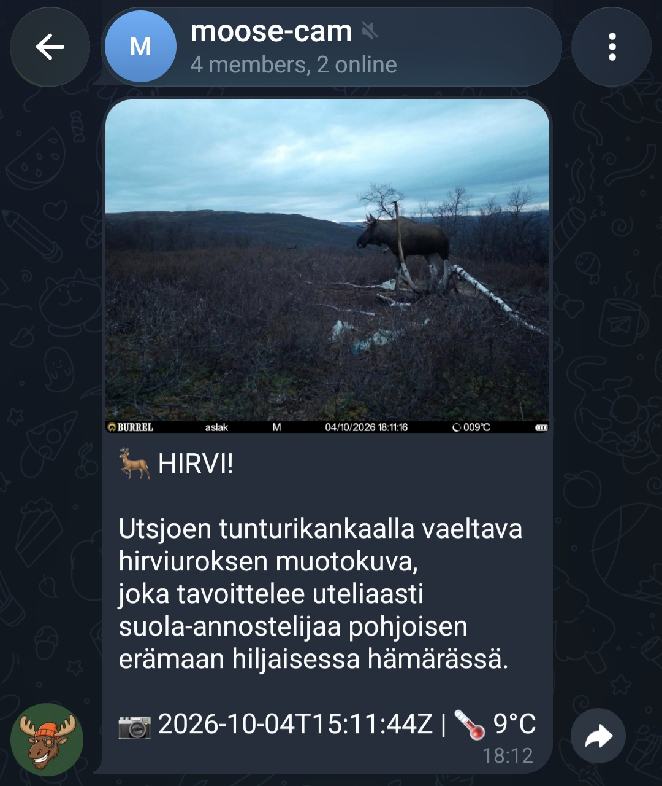
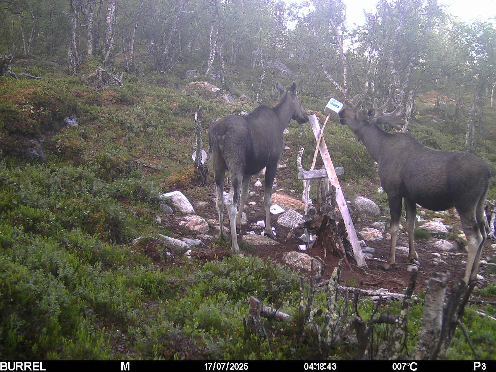
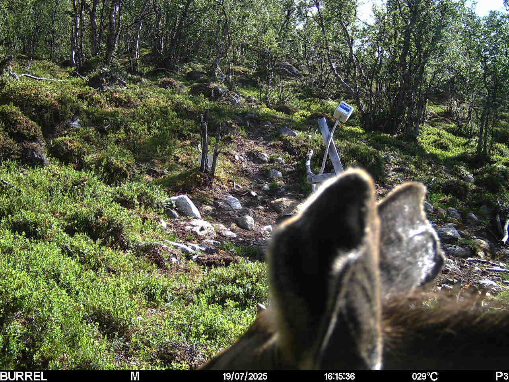
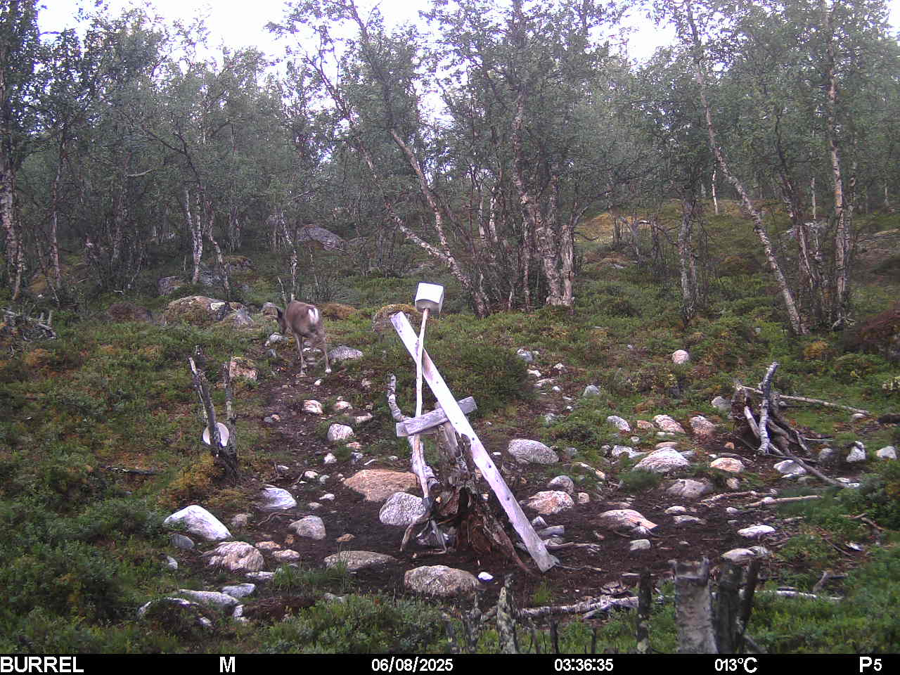
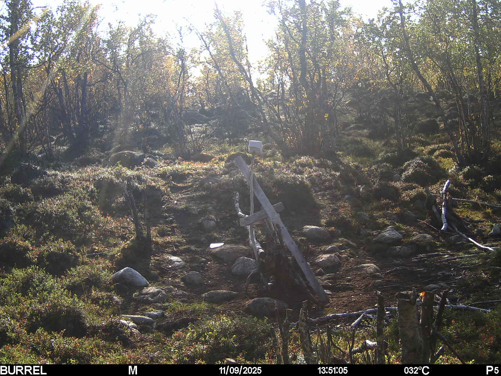
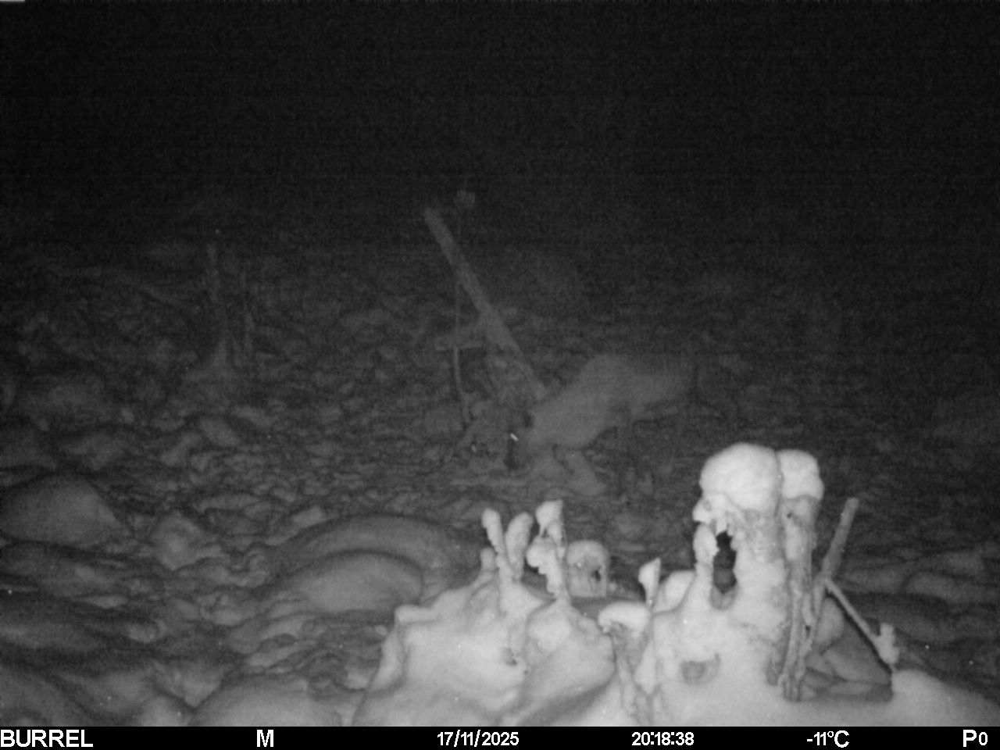

# Moose Cam



Automated moose detection from a Burrel trail camera in northernmost Lapland. When the camera captures a photo with a moose, a message is sent to a Telegram group chat with the image and an AI-generated description.

Uses Google Gemini 3.1 Flash Lite (free tier) for zero-shot classification. Tested with 477 trail camera images; manual check of about 50% showed 100% accuracy across moose, reindeer, hares, and empty frames.

## How it works

```
Burrel camera (Utsjoki)
  → motion trigger → photo
    → Burrel backend
      → Webhook POST → Cloudflare Worker
        → responds 200 OK immediately (<5s)
        → ctx.waitUntil() background:
          → fetch image from Burrel API
          → Gemini classifies: moose or not?
          → if moose → Telegram alert with photo + description
```

## Architecture decisions

| Component | Choice | Why |
|---|---|---|
| **Trigger** | Burrel webhook | Real-time push, no polling |
| **Backend** | Cloudflare Workers (TS) | `ctx.waitUntil()` solves Burrel's 5s timeout, zero cold start, 100K req/day free |
| **AI/Vision** | Google Gemini 3.1 Flash Lite | Fast, good Finnish, cheap, JSON mode built in |
| **Alerts** | Telegram Bot | Free API, supports photos + text, works with fetch() |

**Why Cloudflare Workers over GCP/Azure Functions?** Burrel's webhook requires a response within 5 seconds, but Gemini analysis takes 3-6s. Workers responds immediately and runs analysis in the background with `ctx.waitUntil()`. On GCP you'd need Pub/Sub + two separate functions.

## Project structure

```
moose_cam/
├── worker/                       # Cloudflare Worker (TypeScript)
│   ├── src/index.ts
│   ├── test/index.test.ts
│   ├── wrangler.toml
│   └── package.json
├── testing/                      # Python test scripts (model evaluation)
│   ├── role_preview.py           # Preview caption roles against Gemini
│   ├── test_worker_local.py      # E2E test for local/prod Worker
│   └── copy_test_images.py
├── scripts/
│   └── telegram_send.py          # CLI: send Telegram messages/photos
├── examples/                     # Sample images for README
├── .github/workflows/deploy.yml  # Auto-deploy on push
├── .env.example
└── .gitignore
```

## Model testing

Before building the pipeline, models were tested locally with 954 SD card images.

| Model | API | JSON mode | Finnish | Status |
|---|---|---|---|---|
| Llama 4 Scout 17B | Groq | `response_format` | Weak | Removed from Groq 17.6.2026 |
| Gemini 3.1 Flash Lite | Google AI | `response_mime_type` | Good | **In production** |

**20-image test:** 100% accuracy, precision, and recall (20/20).

**A/B test (477 images):** 17 comparable images -> 100% agreement between models. Manual check of about 50% of Gemini results confirmed all correct, including correct identification of reindeer, hares, and empty frames.

### Example outputs

Real responses from Gemini 3.1 Flash Lite (the "hunter" role):

**PICT1564** - `hirvi: true, luottamus: 1.0` - "Perkele, komia hirvisonni ja lehmä siinä nuolukivellä, syksyn jahteja odotellessa!"


**PICT1711** - `hirvi: true, luottamus: 1.0` - "Perkele, siinähän se hirven korva törröttää aivan linssin edessä, hitonmoinen romuluu."


**PICT2055** - `hirvi: false, luottamus: 1.0` - "Perkeleen poro siellä taas vaeltelee, ei näy sarvipäätä mailla eikä halmeilla."


**PICT2636** - `hirvi: false, luottamus: 1.0` - "Pelkkää risukkoa ja kiviä, ei saatana näy elon merkkiäkään täällä päin."


**PICT2890** - `hirvi: false, luottamus: 0.8` - "Perkele, on se joku näädän tai ahman rääpäle, ei ainakaan hirvi perkule."


PICT2890 is a nigh-time winter photo with a reindeer. The model correctly rejects it as moose but doesn't identify it as a reindeer in the description. Note the lower confidence (0.8): the model knows this one is tricky.

### Prompt engineering lessons

Some findings from four prompt iterations:

- **Don't mention what you're not looking for.** Adding "this is not a reindeer" tanked recall from 100% to 60% across three attempts (on a 20 pic test set, with 10 containing moose). The model got spooked and started calling moose reindeer. Fix: remove all poro mentions, add "large cervid = probably moose" instead. 100% accuracy restored.
- **Location as implicit context.** Saying "Utsjoki, northern Lapland" in the prompt gives the model geographic awareness. It knows reindeer exist there without being told to watch for them. No explicit reindeer instructions needed, and no regressions.
- **Confidence scores are surprisingly useful.** Gemini gives 1.0 for clear moose shots and clear empty frames, but drops to 0.8 for ambiguous cases like a reindeer in winter (PICT2890). Good for flagging edge cases worth reviewing.
- **Persona drives the voice, not the verdict.** The prompt rotates several roles (hunter, animal-rights advocate, Sámi shaman, reindeer herder, deadpan documentary host) for variety, and explicitly instructs the model that the role must not influence the moose/animal classification.
- **Temperature at 1.2.** Runs a bit hot to give the descriptions more range across roles. Could lower it to 0.3-0.5 for more consistent phrasing, but the variety is the point.
- **JSON output works.** Gemini's `response_mime_type: "application/json"` returns clean JSON every time. No regex, no markdown stripping.

## Setup

### Worker (production pipeline)

```bash
cd worker
npm install
cp .dev.vars.example .dev.vars    # fill in secrets
npx wrangler dev                  # local dev server
npx wrangler deploy               # deploy to Cloudflare
```

Secrets (set with `npx wrangler secret put <NAME>`):
- `WEBHOOK_SECRET` - shared secret in the webhook URL query string
- `BURREL_ACCESS_KEY` - Burrel camera access key
- `GEMINI_API_KEY` - Google AI API key
- `TELEGRAM_BOT_TOKEN` - Telegram bot token
- `TELEGRAM_CHAT_ID` - target Telegram chat/group ID

### Test scripts (Python)

```bash
pip install python-dotenv requests
cp .env.example .env              # fill in keys
```

## Auto-deploy

Pushing to `main` with changes in `worker/` triggers a GitHub Actions workflow:

1. `npm ci` - install dependencies
2. `tsc --noEmit` - type check (deploy blocked if this fails)
3. `npm test` - unit tests with vitest (deploy blocked if this fails)
4. `wrangler deploy` - deploy to Cloudflare

Required GitHub repository secrets:
- `CLOUDFLARE_API_TOKEN` - API token with "Workers Scripts: Edit" permission
- `CLOUDFLARE_ACCOUNT_ID` - from Cloudflare dashboard, Workers & Pages

## Camera

- **Model:** Burrel N24
- **Location:** Utsjoki, Sápmi
- **Settings:** Motion trigger, instant send, 10MP, normal sensitivity, 3 min interval (min)
- **API docs:** https://app.burrelcameras.com/api/v1/public/info/

## Future ideas

- **All-animal alerts** - send Telegram notifications for any detected animal, not just moose
- **Monitoring & stats** - track detection counts, response times, and errors (Cloudflare Analytics or a simple KV counter)
- **Result history** - store classification results in Cloudflare D1/KV or an external database for later analysis
- **Multi-camera support** - generalize the Worker to handle webhooks from multiple Burrel cameras
- **Daily digest** - scheduled Worker that sends a daily summary (number of triggers, animals seen, battery/temperature trends)
- **Image gallery** - simple web UI to browse detected moose images with their AI descriptions
- **Model experiments** - try newer/cheaper models as they come out, or fine-tune a small model if Gemini free tier rate limits become a problem.
